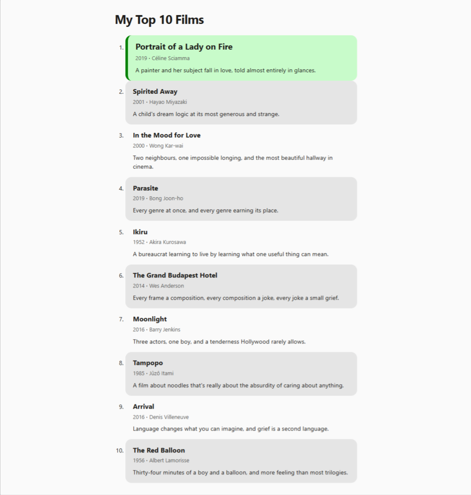
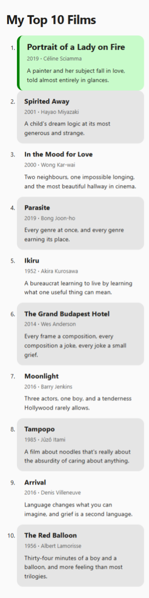

# Favorite Movies List

A ranked top-10 films list, built as part of a front-end learning path.
Focus: styling a repeated list with structural selectors — no class on
any item.

**[→ Live demo](https://TahaSoumbate.github.io/favorite-movies-list/)**

## What's in it

- An `<ol class="movie-list">` with ten ranked films
- Each item: an `<h2>` title, a year/director line in ``s, and a
  one-line review
- Zebra striping with `:nth-child(even)` — no `class="even"` anywhere
- A first-place highlight with `:first-child` — larger title plus a
  7px accent border, so it stands out in greyscale as well as in colour
- Year and director styled through a descendant selector
  (`.movie-list > li span`) rather than per-item classes
- Hover background on rows
- **One class name** in the whole stylesheet

## What I learned

- **If you're adding the same class to every item so your selectors
  work, the selector is wrong.** My first version put
  `class="active"` on all ten `<li>`s and then wrote
  `.active:nth-child(even)`. It *looked* like it was using
  pseudo-classes, but the class was doing all the work — and a new
  plain `<li>` wouldn't stripe. Deleting the class and rewriting as
  `.movie-list > li:nth-child(even)` fixed it and made the stylesheet
  shorter.
- **`>` vs descendant (space) matters, and the two do different jobs.**
  Stripping and highlighting use `.movie-list > li:…` so nested lists
  can't inherit list styles they shouldn't. Year and director use the
  descendant selector `.movie-list > li span` to reach *into* the item,
  which is exactly what the brief asked for.
- **`:first-child` should use more than colour.** In greyscale the
  first film still needs to read as first — I added a larger title
  size and a 7px left border alongside the green background. Colour
  alone fails; border + size pass.
- **Contrast has to be checked against the real background, not
  white.** My muted year text originally used `gray` (`#808080`),
  which passes on a white row and *fails* on the striped row. The fix
  was a darker grey, verified in DevTools against the striped
  background specifically.
- **`!important` is a symptom, not a fix.** I added it to the
  `:first-child` background and broke hover on the first item
  silently — importance beats specificity, so the hover rule couldn't
  win. Removing it was the fix; nothing else changed.

## Tech

Plain HTML and CSS. No frameworks, no build step.

